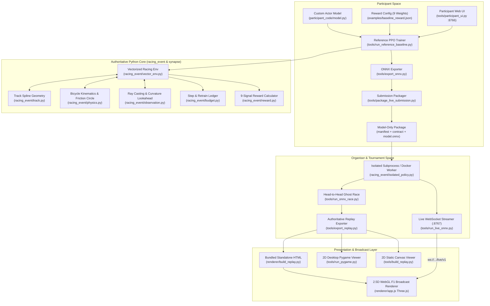

# SYNAPSE: System Architecture & Technical Specification

> **Authoritative Core Principle:** Python is the single source of truth. Python calculates kinematic physics, checks track limits, samples ray sensors, evaluates action deadlines, tallies transition budgets, flags DNFs, and records telemetry. The WebGL 3D renderer, Pygame window, and browser viewer are strictly read-only presentation surfaces that visualize authoritative state packets.

---

## 1. High-Level System Architecture

SYNAPSE is an autonomous racing competition platform powered by reinforcement learning (PPO), deterministic kinematic physics, strict observation/action contracts, transition budget ledgers, and a broadcast-grade 2.5D/3D WebGL renderer.



---

## 2. Directory Structure & File Inventory

| Path | Purpose | Key Responsibilities & Symbols |
|---|---|---|
| [`participant_code/model.py`](file:///d:/synapse_shit/Synapse/participant_code/model.py) | Starter actor network | Implements `build_actor(obs_size) -> nn.Module` returning 2 pre-tanh outputs (steering, throttle/brake). |
| [`participant_code/README.md`](file:///d:/synapse_shit/Synapse/participant_code/README.md) | BYOA documentation | Rules for pluggable PyTorch models. |
| [`synapse/__init__.py`](file:///d:/synapse_shit/Synapse/synapse/__init__.py) | Participant SDK facade | `make_env()`, `parse_args()`, and `save()` for custom research algorithms. |
| [`config/simulation.json`](file:///d:/synapse_shit/Synapse/config/simulation.json) | Authoritative simulation config | Physics limits (tick rate 30 Hz, max speed 80 m/s, grip, drag, ray angles, lookaheads). |
| [`tracks/train/`](file:///d:/synapse_shit/Synapse/tracks/train) | Public circuit definitions | Hand-curated, scaled tracks: `monaco.json` (3,337 m) and `spa.json` (7,004 m). |
| [`tracks/train_manifest.json`](file:///d:/synapse_shit/Synapse/tracks/train_manifest.json) | Cryptographic map registry | SHA-256 hashes, canonical geometry versions, sensor parameters. |
| [`racing_event/physics.py`](file:///d:/synapse_shit/Synapse/racing_event/physics.py) | Vehicle dynamics engine | `CarState`, `CarStateBatch`, `step_car()`, `step_car_batch()`, friction circle, runoff grip penalty. |
| [`racing_event/track.py`](file:///d:/synapse_shit/Synapse/racing_event/track.py) | Geometric track model | `TrackGeometry`, cubic splines, centerline projection, KD-tree nearest-point search, ray-intersection math. |
| [`racing_event/observation.py`](file:///d:/synapse_shit/Synapse/racing_event/observation.py) | Sensor contract & observation builder | `ObservationSchema`, `TrainingContract`, 23-element vector builder (`ObservationBuilder`). |
| [`racing_event/reward.py`](file:///d:/synapse_shit/Synapse/racing_event/reward.py) | Reward calculation | `RewardConfig`, `evaluate_reward_function()`, the 9 published signal weights. |
| [`racing_event/env.py`](file:///d:/synapse_shit/Synapse/racing_event/env.py) | Single-track environment | `RacingEnv`, reset logic, standing starts, DNF detection (`dnf_crash`, `dnf_stuck`, `dnf_timeout`, `dnf_backward`). |
| [`racing_event/vector_env.py`](file:///d:/synapse_shit/Synapse/racing_event/vector_env.py) | High-throughput vectorized env | `VectorizedRacingEnv`, parallel lane stepping, active-masking, automated sub-env reset. |
| [`racing_event/budget.py`](file:///d:/synapse_shit/Synapse/racing_event/budget.py) | Transition ledger | `RunBudget`, POSIX file locking, per-run transition limits (e.g. 10,000 steps). |
| [`racing_event/client_budget.py`](file:///d:/synapse_shit/Synapse/racing_event/client_budget.py) | Client retrain limits | Tracks participant allocation slots (max 12 retrains per client). |
| [`racing_event/budgeted_env.py`](file:///d:/synapse_shit/Synapse/racing_event/budgeted_env.py) | Budget-enforcing environment wrapper | Automatically deducts transitions before stepping active lanes. |
| [`racing_event/ppo.py`](file:///d:/synapse_shit/Synapse/racing_event/ppo.py) | PPO reinforcement learning algorithm | `ActorCritic`, `compute_masked_gae()`, `evaluate_policy()`, clipped surrogate loss, value function clipping. |
| [`racing_event/reference_checkpoint.py`](file:///d:/synapse_shit/Synapse/racing_event/reference_checkpoint.py) | Checkpoint manager | `save_reference_checkpoint()`, `load_reference_checkpoint()`, run identity hashing. |
| [`racing_event/isolated_policy.py`](file:///d:/synapse_shit/Synapse/racing_event/isolated_policy.py) | Sandboxed inference | Runs ONNX policies in bounded subprocesses/Docker containers with memory caps and timeouts. |
| [`racing_event/onnx_artifact.py`](file:///d:/synapse_shit/Synapse/racing_event/onnx_artifact.py) | ONNX validation & loading | Validates input `[1, N]`, output `[1, 2]`, opset 17, operator whitelist, node count, parameter limits. |
| [`racing_event/live_protocol.py`](file:///d:/synapse_shit/Synapse/racing_event/live_protocol.py) | Real-time WebSocket protocol | `LiveStatePublisher`, broadcasts `hello`, `state`, and `end` JSON frames over WebSockets. |
| [`racing_event/live_race.py`](file:///d:/synapse_shit/Synapse/racing_event/live_race.py) | Real-time race runner | Fixed-rate 30 Hz simulation clock, 20 ms policy execution deadline, `strict_scored` vs `trusted_live`. |
| [`racing_event/race.py`](file:///d:/synapse_shit/Synapse/racing_event/race.py) | Offline ghost race runner | Multi-entrant deterministic head-to-head evaluation without live WebSocket overhead. |
| [`racing_event/evaluation.py`](file:///d:/synapse_shit/Synapse/racing_event/evaluation.py) | Deterministic evaluation harness | Multi-repeat lap timing, trajectory digest comparison, consistency audits. |
| [`racing_event/trajectory.py`](file:///d:/synapse_shit/Synapse/racing_event/trajectory.py) | Replay serialization | `save_replay()`, `load_replay()`, Replay Schema 1.1 validation. |
| [`racing_event/pygame_renderer.py`](file:///d:/synapse_shit/Synapse/racing_event/pygame_renderer.py) | 2D desktop renderer | Pygame-based 2D top-down view with telemetry overlays and trajectory breadcrumbs. |
| [`tools/run_reference_baseline.py`](file:///d:/synapse_shit/Synapse/tools/run_reference_baseline.py) | Core training algorithm engine | Full training orchestration: loads tracks, instantiates PPO, evaluates checkpoints, logs metrics. |
| [`tools/train_participant.py`](file:///d:/synapse_shit/Synapse/tools/train_participant.py) | Participant training CLI wrapper | Guarded CLI validating public maps, budgets, contracts, and model hashes. |
| [`tools/participant_ui.py`](file:///d:/synapse_shit/Synapse/tools/participant_ui.py) | Participant web dashboard | Local HTTP service on `http://127.0.0.1:8766` for training, model checks, replay viewing, and live heats. |
| [`tools/check_model.py`](file:///d:/synapse_shit/Synapse/tools/check_model.py) | Pre-training model checker | Validates shapes, finite outputs, parameter counts, ONNX parity, and 20 ms inference latency. |
| [`tools/export_onnx.py`](file:///d:/synapse_shit/Synapse/tools/export_onnx.py) | ONNX model exporter | Converts PyTorch actor or safe NumPy artifact into a validated ONNX model graph. |
| [`tools/package_live_submission.py`](file:///d:/synapse_shit/Synapse/tools/package_live_submission.py) | Submission packager | Compiles `manifest.json`, `training_contract.json`, `model.onnx`, and training provenance. |
| [`tools/export_replay.py`](file:///d:/synapse_shit/Synapse/tools/export_replay.py) | Headless replay exporter | Runs a model or scripted driver on a circuit and dumps a Schema 1.1 `.json` replay. |
| [`tools/run_onnx_race.py`](file:///d:/synapse_shit/Synapse/tools/run_onnx_race.py) | Deterministic head-to-head CLI | Evaluates 1 to 4 entrants on arbitrary tracks offline, outputting `race.json`. |
| [`tools/run_live_onnx.py`](file:///d:/synapse_shit/Synapse/tools/run_live_onnx.py) | Real-time live heat broadcaster | Runs 2+ entrants at 30 Hz with live WebSocket telemetry broadcast. |
| [`tools/run_pygame.py`](file:///d:/synapse_shit/Synapse/tools/run_pygame.py) | Desktop replay viewer | Interactive Pygame window to watch any `.json` replay. |
| [`tools/build_replay.py`](file:///d:/synapse_shit/Synapse/tools/build_replay.py) | 2D replay HTML bundler | Inlines a replay JSON into the 2D canvas viewer (`racing_event/assets/replay.html`). |
| [`renderer/build_replay.py`](file:///d:/synapse_shit/Synapse/renderer/build_replay.py) | 3D WebGL replay HTML bundler | Inlines dual-car replays into the Three.js WebGL broadcast viewer (`artifacts/replay/*.html`). |
| [`renderer/index.html`](file:///d:/synapse_shit/Synapse/renderer/index.html) | WebGL viewer HTML shell | Hero section, circuit cards, 3D viewport, 15-LED RPM lights, timing tower, broadcast bar. |
| [`renderer/style.css`](file:///d:/synapse_shit/Synapse/renderer/style.css) | Broadcast styling | Neo-brutalist F1 TV aesthetic, glassmorphism, responsive controls, HUD styling. |
| [`renderer/app.js`](file:///d:/synapse_shit/Synapse/renderer/app.js) | Three.js WebGL engine | 3D track extrusion, curbs, barriers, grandstands, low-poly animated fans, F1 car meshes, audio synth, cameras. |
| [`renderer/live_source.js`](file:///d:/synapse_shit/Synapse/renderer/live_source.js) | WebSocket telemetry client | Connects to `ws://.../live/v1`, interpolates poses, handles network jitter and disconnects. |

---

## 3. Authoritative Python Core Specifications

### 3.1 Kinematic Physics & Vehicle Dynamics ([`racing_event/physics.py`](file:///d:/synapse_shit/Synapse/racing_event/physics.py))

Vehicle state is modeled via `CarState` (and batched as `CarStateBatch`):
$$\mathbf{s} = [x, y, \psi, v, v_{lat}, \dot{\psi}, \delta, u_{steer}^{prev}, u_{long}^{prev}]^T$$

The simulator advances in discrete time steps of $\Delta t = \frac{1}{\text{tick\_hz}} = \frac{1}{30} \approx 0.0333\text{ s}$:

1. **Steering Dynamics:**
   $$\Delta \delta = \text{clip}\left(u_{steer} \cdot \delta_{max} - \delta, -\dot{\delta}_{max}\Delta t, \dot{\delta}_{max}\Delta t\right)$$
   $$\delta \leftarrow \delta + \Delta \delta$$
   where $\delta_{max} = 0.55\text{ rad} \approx 31.5^\circ$, $\dot{\delta}_{max} = 1.8\text{ rad/s}$.

2. **Longitudinal Acceleration & Braking:**
   - Throttle: $a_{throttle} = \max(0, u_{long}) \cdot a_{max} \cdot \left(1 - \frac{v}{v_{max}}\right)$
   - Brake: $a_{brake} = \max(0, -u_{long}) \cdot a_{brake\_max}$
   - Drag: $a_{drag} = c_{drag} \cdot v^2$
   - Net: $a_{net} = a_{throttle} - a_{brake} - a_{drag}$
   - Velocity update: $v \leftarrow \text{clip}\left(v + a_{net} \Delta t, 0, v_{max}\right)$ where $v_{max} = 80.0\text{ m/s}$ (288 km/h), $a_{max} = 8.0\text{ m/s}^2$, $a_{brake\_max} = 18.0\text{ m/s}^2$, $c_{drag} = 0.008\text{ m}^{-1}$.

3. **Friction Circle & Lateral Dynamics:**
   - Peak grip: $a_{grip} = a_{lat\_peak} \cdot k_{runoff}$ ($a_{lat\_peak} = 28.0\text{ m/s}^2 \approx 2.85\text{ G}$, $k_{runoff} = 0.55$ when off-track, $1.0$ on tarmac).
   - Usable lateral acceleration:
     $$a_{lat\_usable} = \sqrt{\max\left(0, a_{grip}^2 - \min(|a_{net}|, a_{grip})^2\right)}$$
   - Kinematic yaw rate request:
     $$\dot{\psi}_{req} = \frac{v \cdot \tan(\delta)}{L_{wheelbase}} \quad (L_{wheelbase} = 2.8\text{ m})$$
   - Lateral acceleration check: if $|v \cdot \dot{\psi}_{req}| > a_{lat\_usable}$, yaw rate is capped to:
     $$\dot{\psi} = \text{sgn}(\dot{\psi}_{req}) \cdot \frac{a_{lat\_usable}}{\max(v, 10^{-6})}$$
   - Position Integration:
     $$\psi \leftarrow \psi + \dot{\psi} \Delta t$$
     $$x \leftarrow x + v \cdot \cos\left(\psi - 0.5 \dot{\psi} \Delta t\right) \Delta t$$
     $$y \leftarrow y + v \cdot \sin\left(\psi - 0.5 \dot{\psi} \Delta t\right) \Delta t$$

---

### 3.2 Track Spline Geometry & Ray Sensors ([`racing_event/track.py`](file:///d:/synapse_shit/Synapse/racing_event/track.py))

- **Centerline Representation:** Closed cubic spline parameterised by arc-length $s \in [0, L_{lap}]$.
- **Track Boundaries:** Inner and outer boundary walls calculated by offsetting normal vectors by local half-widths.
- **Runoff Aprons & Barrier Walls:** Runoff extends outward by an additional $5.0\text{ m}$; TecPro barrier walls form the solid collision perimeter.
- **Ray-Casting:** Casts lines from the car's front axle at configured angles $[-90^\circ, -60^\circ, -30^\circ, -15^\circ, 0^\circ, 15^\circ, 30^\circ, 60^\circ, 90^\circ]$ out to $100.0\text{ m}$. Intersections with boundary walls are computed analytically via 2D segment intersection tests.

---

### 3.3 Observation Vector & Contract Schema ([`racing_event/observation.py`](file:///d:/synapse_shit/Synapse/racing_event/observation.py))

Observations are track-relative float32 vectors of dimension $D = 10 + N_{rays} + N_{lookahead} = 23$:

| Index | Field Name | Bounds | Unit / Normalization | Description |
|---|---|---|---|---|
| 0 | `speed` | $[0.0, 1.0]$ | Normalized | $v / v_{max}$ |
| 1 | `longitudinal_velocity`| $[-1.0, 1.0]$| Normalized | Signed forward velocity / $v_{max}$ (no reverse in v1) |
| 2 | `lateral_velocity` | $[-1.0, 1.0]$| Normalized | Body-frame lateral slip / $v_{max}$ |
| 3 | `yaw_rate` | $[-1.0, 1.0]$| Normalized | Clipped to $\pm 5.0\text{ rad/s}$ |
| 4 | `lateral_offset` | $[-1.0, 1.0]$| Normalized | Distance from centerline / track width |
| 5 | `heading_error` | $[-1.0, 1.0]$| Normalized | Angle difference relative to spline tangent / $\pi$ |
| 6 | `previous_steering` | $[-1.0, 1.0]$| Normalized | Prior step steering action |
| 7 | `previous_longitudinal`| $[-1.0, 1.0]$| Normalized | Prior step throttle/brake action |
| 8 | `steering_angle` | $[-1.0, 1.0]$| Normalized | Current wheel angle / $\delta_{max}$ |
| 9–17 | `ray_0` to `ray_8` | $[0.0, 1.0]$ | Normalized | Ray boundary distance / $100.0\text{ m}$ (angles: $0^\circ, \pm 15^\circ, \pm 30^\circ, \pm 60^\circ, \pm 90^\circ$) |
| 18–21| `curvature_0` to `3` | $[-1.0, 1.0]$| Normalized | Spline curvature at lookahead distances $[15, 40, 80, 140]\text{ m}$ |
| 22 | `local_width` | $[0.0, 1.0]$ | Normalized | Local road width / reference width |

---

### 3.4 Reward Function & The 9 Signals ([`racing_event/reward.py`](file:///d:/synapse_shit/Synapse/racing_event/reward.py))

The total scalar reward $R_t$ is a linear combination of 9 transition signals:
$$R_t = \sum_{k=1}^9 w_k \cdot S_k$$

```json
{
  "schema_version": 1,
  "weights": {
    "progress": 12.0,
    "speed": 0.5,
    "curvature_matched_speed": 0.25,
    "off_track": -1.5,
    "crash": -10.0,
    "stuck": -8.0,
    "lap_complete": 20.0,
    "time": -0.15,
    "steer_smoothness": -0.05
  }
}
```

- `progress`: Arc-length distance advanced along the track centerline (metres).
- `speed`: Forward speed normalized $[0, 1]$.
- `curvature_matched_speed`: Reward for matching speed to oncoming corner curvature $\kappa$.
- `off_track`: Penalty applied when wheels exceed track boundary lines onto runoff aprons.
- `crash`: Terminal penalty for touching the outer barrier perimeter.
- `stuck`: Penalty when forward speed remains below $0.5\text{ m/s}$ for $>90$ consecutive ticks.
- `lap_complete`: Bonus for completing a full lap through the start/finish line.
- `time`: Constant small per-tick cost ($-0.15$) to prevent idling.
- `steer_smoothness`: Penalty proportional to $(\Delta u_{steer})^2$ to prevent high-frequency jitter.

---

### 3.5 Reinforcement Learning (PPO) & Budgeting ([`racing_event/ppo.py`](file:///d:/synapse_shit/Synapse/racing_event/ppo.py))

- **Algorithm:** Proximal Policy Optimization (PPO) with Generalized Advantage Estimation (GAE).
- **Actor:** Evaluates observations and outputs action distribution means $\mu \in \mathbb{R}^2$. Standard deviation $\sigma$ is learned as a state-independent parameter.
- **Critic:** Value function $V(s)$ estimating expected discounted return.
- **Action Sampling:** Actions are sampled from $\mathcal{N}(\mu, \sigma)$ during training; evaluation and replays execute deterministically with $a = \tanh(\mu)$.
- **Transition Budgeting:** Each training allocation permits up to 10,000 steps. A client ledger (`.synapse/client_training_budget.json`) enforces a hard ceiling of 12 retrain allocations per client. Active lanes are locked and deducted atomically using POSIX file locks.

---

## 4. Participant Workflow & BYOA (Bring Your Own Architecture)

1. **Model Definition:** Define `build_actor(obs_size: int) -> nn.Module` in [`participant_code/model.py`](file:///d:/synapse_shit/Synapse/participant_code/model.py). The network must accept an input tensor of shape `[batch, obs_size]` and return pre-tanh means of shape `[batch, 2]`.
2. **Pre-Training Verification:** Run [`tools/check_model.py`](file:///d:/synapse_shit/Synapse/tools/check_model.py) to confirm:
   - Zero NaNs / Infs on random inputs.
   - Strict output shapes of `[1, 2]`.
   - ONNX export compatibility and operator whitelist verification.
   - Inference latency under the 20 ms live deadline.
3. **Training:** Run [`tools/train_participant.py`](file:///d:/synapse_shit/Synapse/tools/train_participant.py) across both public training maps (`monaco.json` and `spa.json`).
4. **Diagnostic Evaluation:** Test the trained checkpoint on Monaco and Spa via [`tools/evaluate_both.py`](file:///d:/synapse_shit/Synapse/tools/evaluate_both.py).
5. **ONNX Export:** Export to model-only ONNX via [`tools/export_onnx.py`](file:///d:/synapse_shit/Synapse/tools/export_onnx.py).
6. **Submission Packaging:** Bundle the model, contract, and provenance into a verifiable directory via [`tools/package_live_submission.py`](file:///d:/synapse_shit/Synapse/tools/package_live_submission.py).

---

## 5. Organiser Subsystem & Tournament Execution

1. **Submission Audit:** Organisers validate participant packages using [`racing_event/onnx_artifact.py`](file:///d:/synapse_shit/Synapse/racing_event/onnx_artifact.py):
   - ONNX Opset 17, IR version 10.
   - Permitted operators: `Gemm`, `MatMul`, `Add`, `Sub`, `Mul`, `Div`, `Min`, `Max`, `Relu`, `Tanh`, `Sigmoid`, `Clip`, `Identity`, `Cast`.
   - Structural limits: $\le 128$ nodes, $\le 1,000,000$ parameters, static rank-2 tensors.
2. **Subprocess Isolation:** Models run inside isolated worker processes ([`racing_event/isolated_policy.py`](file:///d:/synapse_shit/Synapse/racing_event/isolated_policy.py)) with strict memory quotas (512 MB) and startup timeouts (30 s).
3. **Ghost Racing:** Matches run as ghost heats (cars share track geometry but do not collide physically).
4. **Live Race Broadcaster:** [`tools/run_live_onnx.py`](file:///d:/synapse_shit/Synapse/tools/run_live_onnx.py) runs the 30 Hz simulation loop and broadcasts JSON telemetry over WebSockets to spectators and broadcast overlays.
5. **Enforced Action Budgets:** Each entrant has a strict 20.0 ms inference budget per tick. Under `--late-policy strict_scored`, any timeout or invalid action triggers an instant `dnf_inference`.

---

## 6. Presentation Layer & WebGL 3D Renderer

The visual renderer in [`renderer/`](file:///d:/synapse_shit/Synapse/renderer/) is a standalone 2.5D/3D WebGL F1 TV broadcast viewer built with Three.js:

```
renderer/
├── index.html        # F1 TV broadcast shell, hero launcher, timing tower, telemetry HUD
├── style.css         # Neo-brutalist styling, glassmorphism, responsive grid, camera controls
├── app.js            # Three.js 3D engine (circuit extrusion, F1 car meshes, audio synth, cameras)
├── live_source.js    # WebSocket client (connects to ws://.../live/v1, buffer interpolation)
└── build_replay.py   # Bundles index.html + style.css + app.js + replays into single portable HTML
```

### Key Renderer Capabilities
- **Dual Operating Modes:** Can play recorded Schema 1.1 JSON replays or stream live races over WebSockets (`?live=ws://...`).
- **Hero Section Launchpad:** Pre-race intro showcasing 6 cinematic camera cuts rotating every 4.5 seconds with visual circuit and racer cards.
- **Dynamic Camera System:** 6 switchable camera views:
  1. `[1] Battle Cam`: Smooth centroid tracking between Car 1 and Car 2.
  2. `[2] Car A Chase`: 3rd-person chase camera locked to Racer Alpha.
  3. `[3] Car B Chase`: 3rd-person chase camera locked to Racer Beta.
  4. `[4] Cockpit Cam`: First-person halo/nose POV.
  5. `[5] Top Drone Cam`: Overhead tactical circuit view.
  6. `[6] Side Trackside Cam`: Low-slung television broadcast tracking shot.
- **Dynamic X-Ray Overlap Mode:** When two cars get within $2.8\text{ m}$ of each other, car bodies smoothly turn semi-transparent (45% opacity) with glowing holographic wireframes (Cyan `#00f0ff` vs Solar Gold `#ffaa00`), preventing clipping artifacts.
- **Audio Engine:** Dual-engine procedural Web Audio synthesizer (8-gear V6 turbo engine RPM sweep, crowd formant filter cheering swells) with automatic fallback/loading of custom audio assets (`hero_bgm.mp3`, `crowd_noise.mp3`, `bg_sound.mp3`, `engine_sound.mp3`).
- **Telemetry HUD:** 15-LED sequential shift light bar, digital speedometer (km/h), steering angle readout, lateral G-meter, throttle/brake gauges, timing tower intervals, and podium victory modal.

---

## 7. Authoritative Replay Data Contract (Schema 1.1)

Replays are structured JSON documents containing complete, immutable simulation logs:

```json
{
  "schema_version": "1.1",
  "meta": {
    "participant_id": "team-alpha",
    "track_id": "monaco",
    "timestamp": "2026-10-27T19:00:00Z",
    "tick_hz": 30,
    "total_steps": 1200,
    "result": "finished"
  },
  "track": {
    "meta": { "content_hash": "05fb50b..." },
    "centerline": [[0.0, 0.0], [5.2, 1.1], ...],
    "inner_boundary": [[...], ...],
    "outer_boundary": [[...], ...]
  },
  "frames": [
    {
      "step": 0,
      "time_s": 0.0,
      "x": 0.0,
      "y": 0.0,
      "heading": 1.5708,
      "speed": 0.0,
      "steering_angle": 0.0,
      "action": [0.0, 1.0],
      "lateral_offset": 0.0,
      "lap": 0,
      "lap_progress": 0.0,
      "events": []
    }
  ]
}
```

---

## 8. Platform Support & Operational Boundaries

| Component | Windows Native | Linux / WSL | Notes |
|---|---|---|---|
| **WebGL Renderer (`renderer/`)** | Supported | Supported | Pure web standard (Three.js WebGL). Runs in Chrome, Edge, Firefox. |
| **Standalone HTML Replays** | Supported | Supported | Single self-contained HTML file. No dependencies required. |
| **Python Simulation & ONNX Export** | Supported | Supported | `tools/export_replay.py`, `renderer/build_replay.py`, `tools/export_onnx.py`. |
| **Participant CLI & UI Dashboard** | WSL / Linux | Supported | Uses POSIX `fcntl` file locking and `resource` module for budget security. |
| **Participant Training (`train_participant.py`)** | WSL / Linux | Supported | Requires Python 3.11 with POSIX file locking. |
| **Live Head-to-Head Server (`run_live_onnx.py`)** | Supported | Supported | WebSocket streaming server works cross-platform. |
